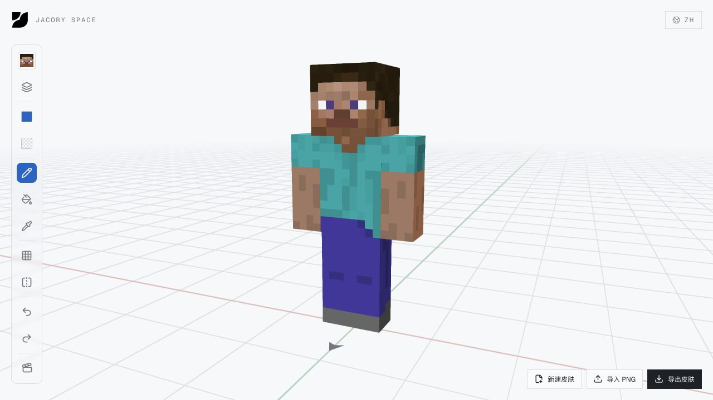

<p align="right"><a href="./README.md">简体中文</a> · <a href="./README.en.md">English</a> · 日本語</p>

[](https://jacoryspace.top/)

# Jacory Space

### アイデアを、動かそう。

書き留めたいアイデアもあれば、手を動かして形にしたいアイデアもある。

Jacory Space は、ブラウザの中に開いた私の小さなアトリエです。好奇心を道具に、考えを手記に、繰り返し役立ったやり方を持ち帰れるレシピにしています。

Minecraft のスキンを描き直したり、仕事や創作についての文章を読んだり、次の制作で使えそうな Prompt を探したり。

気軽にのぞいてみてください。ちょうど欲しかった小さな何かが、見つかるかもしれません。

**[中をのぞく ↗](https://jacoryspace.top/)** · [道具を探す](https://jacoryspace.top/tools) · [レシピを読む](https://jacoryspace.top/library) · [手記を読む](https://jacoryspace.top/blog)

---

## 01 / まずは、ひとまわり

ホームページは **WHO AM I?** という問いから始まります。動くモノ、ドットの表現、そしてデザイン、写真・映像、開発の断片が続きます。

この入口も、アトリエでつくった作品のひとつ。下へスクロールして、私なりの自己紹介を見てみてください。

[](https://jacoryspace.top/)

## 02 / 今日は、何をしてみますか？

| こんな気分なら | ここからどうぞ |
| --- | --- |
| 自分の手で、少し変えてみたい | [索引](https://jacoryspace.top/tools)には、道具、作品、インターフェースの実験が並んでいます。ひとつ開いて、触ってみてください。 |
| 次の制作を助けるものが欲しい | [レシピ](https://jacoryspace.top/library)には Prompt、Agent Skill、使い方を収録。外部の素材は出典も確認できます。 |
| ひとつの問いを、もう少し考えたい | [手記](https://jacoryspace.top/blog)には、プロダクト、AI、仕事、学びについての観察や、考え途中のことを残しています。 |

### 四角い友だちに、新しい服を

3D のキャラクターに直接描いて、角度を変えて確かめる。ミラー描画を試したり、外側のレイヤーを調整したり、動かして眺めたり。

[Minecraft スキンワークベンチ](https://jacoryspace.top/tools/minecraft-skin-editor)では、スキンの新規作成、PNG の読み込み、書き出しができます。展開図のすべてを覚える前に、まずは数筆描いてみましょう。

[](https://jacoryspace.top/tools/minecraft-skin-editor)

### 役立つやり方は、持ち帰れます

各レシピには、何に役立つか、どう使うか、どこまでできるかを記しています。Prompt で Minecraft キャラクターの二方向プレビューを用意したり、出典をたどって Three.js や GSAP の Skill パッケージを見つけたりできます。

自分でまとめた内容と、出典を明記した外部の資料を収録しています。合うものがあれば、あなた自身の制作に取り入れてみてください。

[](https://jacoryspace.top/library)

**[レシピを探す ↗](https://jacoryspace.top/library)**

### 何もつくらず、少し読むだけでも

手記にはフレームワークの調査もあれば、日常に近い問いもあります。良い仕事の状態とは何だろう。知識が増えることと、理解することは同じだろうか。

まずは[「良い仕事の状態とは、役立つことに集中していること」](https://jacoryspace.top/blog/016-good-work-state)（中国語）から。記事同士のリンクをたどって、読み進めることもできます。

### ブラウザの外へ育っていく作品も

[Media Parser](https://jacoryspace.top/tools/media-parser)は、動画、ポッドキャスト、ダウンロード、文字起こしを扱う独立したデスクトップアプリです。このサイトでは紹介と入口を用意し、ソフトウェアは専用のリポジトリで開発を続けています。

[ソフトウェアのリポジトリ](https://github.com/JacoryCYJin/media-parser) · [ダウンロード](https://github.com/JacoryCYJin/media-parser/releases)

## 03 / なぜ、ひとつの場所に？

コードも、画像も、ノートも、同じ問いから生まれることがあります。道具が作品になり、ノートから方法が見つかり、その方法が次の制作を助けてくれる。

そんな行き来を残せる場所が欲しいと思いました。

余白も、少し遊び心のある実験も。できあがったものも、まだ考え途中のことも。こうした積み重ねを、私は **Personal OS** と呼んでいます。

## 04 / 扉は開けたまま、制作中

Jacory がデザイン、開発、執筆、整理を続けています。インターフェースとコンテンツへの入口は簡体字中国語・英語・日本語に対応し、個々の素材や記事はそれぞれの原文で掲載しています。

不具合や、使ってみて浮かんだ面白いアイデアがあれば、[Issue](https://github.com/JacoryCYJin/jacory-space/issues)へどうぞ。つくっている人のことが気になったら、[About](https://jacoryspace.top/about)にもお立ち寄りください。

---

<details>
<summary>作業台の下をのぞく：ローカル実行とドキュメント</summary>

Vue 3、Vite / Vite SSG、Tailwind CSS、GSAP、Three.js を使用しています。記事は Markdown で管理し、公開ページはビルド時に静的 HTML として生成します。

このリポジトリ内で実行：

```bash
cd jacory-space-frontend
npm install
npm run dev
```

ローカルのアドレスは `http://localhost:3001` です。`npm run build` でビルドし、`npm run preview` で出力を確認できます。

[フロントエンドの説明](./jacory-space-frontend/README.md) · [プロジェクト文書](./docs/README.md) · [ブログの Markdown 記法](./docs/reference/blog-markdown.md)

</details>
